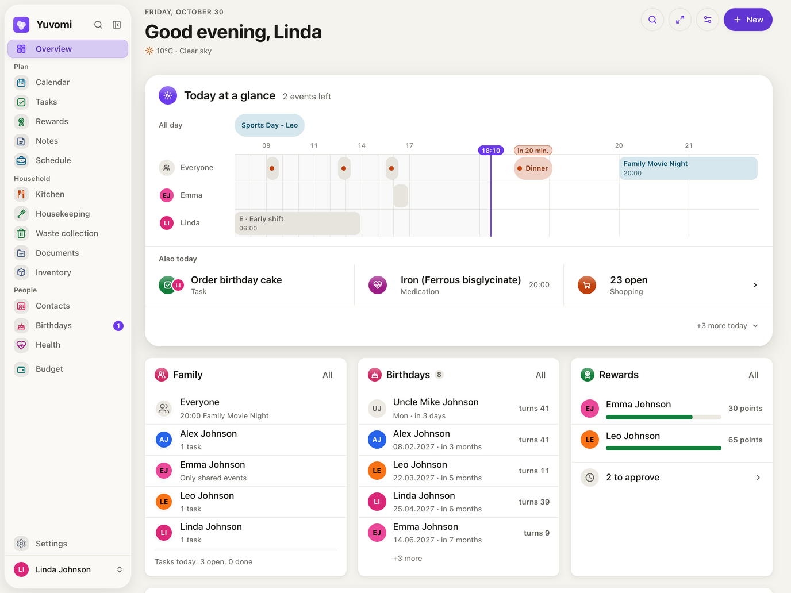

<div align="center">


# Yuvomi for Home Assistant

**The self-hosted family planner [Yuvomi](https://github.com/ulsklyc/yuvomi), packaged as a Home Assistant app.**<br>
Tasks, calendar, shopping, meals, budget and more, in your Home Assistant sidebar, signed in with your Home Assistant users.

[](https://github.com/Phillipxh/ha-yuvomi/releases)
[](https://github.com/Phillipxh/ha-yuvomi/actions/workflows/lint.yaml)
[](https://github.com/ulsklyc/yuvomi/releases)

[](LICENSE)

[](https://my.home-assistant.io/redirect/supervisor_add_addon_repository/?repository_url=https%3A%2F%2Fgithub.com%2FPhillipxh%2Fha-yuvomi)

<picture>
  <source media="(prefers-color-scheme: dark)" srcset=".github/assets/dashboard-dark-web.png">
  
</picture>

<sub>Screenshot: Yuvomi project</sub>

</div>

## Features

- **Runs the official Yuvomi image.** No fork of the app. The add-on only adds the Home Assistant integration around it.
- **Lives in your sidebar.** Turn on *Show in sidebar* and Yuvomi opens as a panel next to your dashboards.
- **Sign in with Home Assistant.** Your Home Assistant users are the Yuvomi accounts. Link existing accounts with one option, no extra passwords needed.
- **Configured in the Home Assistant UI.** Public URL, reverse proxy, weather, calendar sync, backups, plus any Yuvomi variable as `KEY=VALUE`.
- **Part of your Home Assistant backups.** Database, encryption key, documents and Yuvomi's own nightly backups live in the app's data folder, and Home Assistant backs them up consistently (cold backup).
- **Secrets handled for you.** Session secret and database key are generated on first start and never leave the app.
- **amd64 and aarch64.** Works on Home Assistant OS or Supervised, e.g. on a NUC, Home Assistant Green, Yellow or a Raspberry Pi 4/5.

## Installation

1. Click the button above, or add `https://github.com/Phillipxh/ha-yuvomi` under **Settings → Apps → App store → ⋮ → Repositories**.
2. Install **Yuvomi** and start it.
3. Open Yuvomi on port `3000` of your Home Assistant host and create the first account. That account becomes the administrator.

The **Documentation** tab of the app explains every option.

## Sidebar and HTTPS

Yuvomi cannot run below Home Assistant's ingress path yet. The sidebar panel therefore embeds Yuvomi's own HTTPS address. A typical setup:

```yaml
base_url: https://family.example.com   # reverse proxy → http://<home-assistant-ip>:3000
behind_https_proxy: true
```

The proxy must allow Home Assistant to frame Yuvomi (`frame-ancestors`). The [documentation](yuvomi/DOCS.md#showing-yuvomi-in-the-sidebar) has a ready-made snippet for Nginx Proxy Manager.

## Sign in with Home Assistant

```yaml
homeassistant_login: true
homeassistant_url: https://ha.example.com
allow_signup: true          # new Home Assistant users get an account automatically
password_login: true        # set to false to allow Home Assistant sign-in only
link_accounts:
  - alex=0123456789abcdef0123456789abcdef   # existing Yuvomi account = Home Assistant user ID
```

Yuvomi only asks Home Assistant *who* signed in and revokes the token right away. It gets no further access to your Home Assistant.

> [!NOTE]
> Home Assistant sign-in is proposed to Yuvomi in [ulsklyc/yuvomi#2428](https://github.com/ulsklyc/yuvomi/pull/2428). Until it is merged, this app applies it as a small patch ([`yuvomi/patches`](yuvomi/patches)).

## Moving an existing Yuvomi installation

Already running Yuvomi in Docker? Your database, encryption key and documents can be moved into the app, and so can Yuvomi's own backups. The steps are in the [documentation](yuvomi/DOCS.md#moving-an-existing-yuvomi-installation-into-the-app).

## FAQ

<details>
<summary><b>Why does the sidebar need an HTTPS address?</b></summary>

Yuvomi loads all its files from `/`, so it cannot be served below Home Assistant's ingress path (`/api/hassio_ingress/…`). The panel embeds Yuvomi's own address instead. Browsers block plain `http://` pages inside an HTTPS Home Assistant.
</details>

<details>
<summary><b>Is my data safe when I update the app?</b></summary>

Updates keep the `/data` folder. Yuvomi migrates its database forward on start, and these migrations cannot be undone. Create a Home Assistant backup before you update; the app is included in it.
</details>

<details>
<summary><b>The login inside the sidebar opens a new window. Is that intended?</b></summary>

Yes. Home Assistant, like most identity providers, refuses to show its login page inside another site's frame. The sign-in runs in a separate window, and the panel reloads by itself once you are signed in.
</details>

## Support

- Problems with the app: [open an issue](https://github.com/Phillipxh/ha-yuvomi/issues/new/choose)
- Questions and ideas: [Discussions](https://github.com/Phillipxh/ha-yuvomi/discussions)
- Problems with Yuvomi itself: [ulsklyc/yuvomi](https://github.com/ulsklyc/yuvomi/issues)

## Credits

[Yuvomi](https://github.com/ulsklyc/yuvomi) is made by [ulsklyc](https://github.com/ulsklyc) and contributors and is MIT licensed. The logo and screenshots come from the Yuvomi project. This is a community package. It is not affiliated with or endorsed by the Yuvomi project or the Open Home Foundation.

## License

[MIT](LICENSE)
